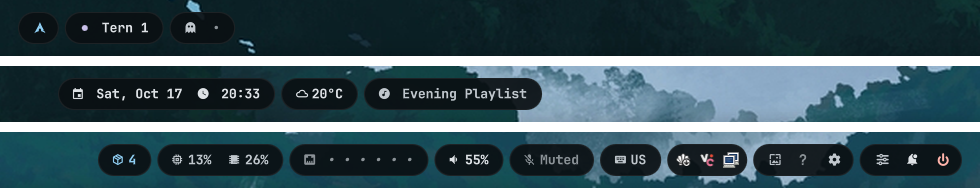

# tern-bar

A clean, floating top bar for the [niri](https://github.com/YaLTeR/niri) desktop. Everything sits in
small rounded "pills" that can follow your wallpaper's colors.



## What you get

- Workspaces and the name of the window you're using
- An app launcher built into the bar: apps, open windows, a calculator, clipboard history and
  power actions, in a card that drops out of the launcher pill
- Quick settings: Wi-Fi, Bluetooth (with your paired devices), Do Not Disturb, night light,
  microphone mute, screen brightness and microphone input volume sliders, and power profile
- A month calendar and a five-day weather forecast under the clock and weather pills
- A small volume or brightness pop-up whenever the volume or screen brightness changes
- Date, time and current weather (condition icon + temperature, no API key needed)
- What's playing, with an expanded media player card (album art, track progress/seek bar, previous /
  play-pause / next, and a player switcher) on left-click, or quick play/pause on right/middle-click
- Pending Arch/Pacman/AUR package updates (`󰏗 <count>`), with a click to update in your terminal
- Active XKB keyboard layout indicator (`󰌌 US`, `JP`, …) from niri, with a click or scroll to switch
- System battery status with charging state and low-battery warnings (hidden on desktops without a battery)
- Microphone input status and mute pill (`󰍬` / `󰍭`) alongside output volume
- CPU and memory at a glance
- Wi-Fi, volume, notifications and a power button
- A system tray with proper right-click menus
- A Tern pill that shows how many Tern windows are open, and opens a terminal tab in one — or a new
  window when none is open (only if you use Tern)
- A wallpaper picker and colour controls, in the same window as the layout editor
- An optional little desktop pet — needs the tern-poke plugin for Tern (not released yet)

## Set it up

You'll need [Quickshell](https://quickshell.org) 0.3 or newer, [niri](https://github.com/YaLTeR/niri),
and the JetBrainsMono Nerd Font.

```bash
git clone https://github.com/Tsukabe-Admin/tern-bar ~/.config/quickshell/tern-bar
quickshell -c tern-bar
```

To start it every time you log in, and to make the settings window float, add this to your niri
config (`~/.config/niri/config.kdl`):

```kdl
spawn-at-startup "quickshell" "-c" "tern-bar"

window-rule {
    match title="^tern-bar settings$"
    match title="^Wallpaper folder$"
    open-floating true
}

binds {
    Mod+B { spawn "quickshell" "ipc" "-c" "tern-bar" "call" "settings" "toggle"; }
    Mod+W { spawn "quickshell" "ipc" "-c" "tern-bar" "call" "settings" "wallpaper"; }
    Mod+Space { spawn "quickshell" "ipc" "-c" "tern-bar" "call" "launcher" "toggle"; }
    Mod+V { spawn "quickshell" "ipc" "-c" "tern-bar" "call" "launcher" "clipboard"; }
    Mod+Return { spawn "quickshell" "ipc" "-c" "tern-bar" "call" "tern" "open"; }
}
```

(If you already have a `binds { }` block, put those lines inside it instead. Other things a key can call:
`launcher power`, `launcher close`, `bar calendar`, `bar media`, `bar quickSettings`, `bar close`,
`tern open`.)

Edit any file and the bar updates on the spot. Your own settings are saved in
`~/.config/tern-bar/`, never inside this folder, so `git pull` is always safe.

### Other programs it uses

Each one is only needed for the part it powers; the rest of the bar works without it.

| Program | Used for |
|---|---|
| `awww` (and its `awww-daemon`) | setting the wallpaper (Wallpaper tab) |
| `matugen` | colours taken from the wallpaper (the built-in themes don't need it) |
| `jq`, `python3` | the wallpaper, colour and weather scripts |
| `zenity` | the "Change folder…" picker |
| `swaync` | the notification bell and Do Not Disturb (the bell hides itself without it) |
| `cliphist`, `wl-clipboard` | clipboard history in the launcher (with `wl-paste --watch cliphist store` running); copying calculator answers |
| `swaylock` | Lock and Suspend (without it, `loginctl lock-session` is used) |
| `wlsunset` | night light |
| `brightnessctl`, `/sys/class/backlight` | the screen brightness slider in quick settings and the brightness OSD (hidden when no backlight device exists) |
| `checkupdates` (`pacman-contrib`), `paru` or `yay` | the package updates pill (hidden when 0 updates are pending or `pacman` is absent) |
| `systemd` (`systemctl`, `loginctl`, `busctl`, `udevadm`) | Suspend, Reboot and Power off; Lock when swaylock is missing; finding the power-profile service; backlight uevents |
| `power-profiles-daemon`, UPower | the power profile switch; the system battery pill (hidden on desktops without a battery) |
| BlueZ, `blueman` | the Bluetooth tile and device list; the "Bluetooth settings" button |
| NetworkManager | the Wi-Fi tile |
| `pavucontrol`, PipeWire | right-click on volume or microphone; the volume and microphone pills and quick-settings controls |
| `nm-connection-editor`, `nmcli` or `iwgetid` | right-click on network; the Wi-Fi name |
| `notify-send` | the "IP hidden / shown" message |
| `tern` | the Tern pill — it hides itself when `tern` isn't on your PATH or in `~/.local/bin` |
| tern-poke (a Tern plugin, not released yet) | the PokeToken pill and the desktop pet — both stay hidden without it |

## Wallpaper and colors

The settings page has two tabs: **Layout** (see [Make it yours](#make-it-yours)) and **Wallpaper**.
The Wallpaper tab is a thumbnail grid of your wallpaper folder (`~/Pictures/Wallpapers` until you
pick another) — search, favourites, shuffle and automatic rotation — plus a per-screen choice (one
image everywhere, or a single screen with its own), fill mode and edge colour, animated
transitions, and the colour controls below. Wallpapers are drawn by `awww`; the bar starts it when
needed and puts your wallpaper back every time it starts. Until you pick one, the bar leaves your
desktop's wallpaper alone.

Everything the tab does is two scripts in `scripts/`: `wallpaper.sh` puts an image on screen and
`theme-sync.sh` recolours. Your choices are saved in `~/.config/tern-bar/wallpaper.json`; the bar is
its only writer.

### Colors from the wallpaper

With "Colours from wallpaper" on (and [matugen](https://github.com/InioX/matugen) installed), the
bar takes its colours from the *All screens* image, using the Material scheme and contrast you
pick. Without a wallpaper or matugen, it keeps its built-in dark blue colours. The bar always uses
the dark variant, whatever the wallpaper. Warning and OK colours stay yellow and green so they keep
their meaning.

If you already use matugen for other apps, nothing extra is needed: the same run also renders
the templates in your `~/.config/matugen/config.toml`.

### Built-in themes

Turn "Colours from wallpaper" off and the bar is painted from one of ten presets — Catppuccin
Mocha, Tokyo Night, Nord, Gruvbox Dark, Dracula, Rosé Pine, Everforest Dark, Kanagawa Wave, One
Dark, Solarized Dark — listed in `themes/presets.json`. They don't need matugen. Changing the
wallpaper then leaves the colours alone. If matugen is installed, your matugen templates follow
the preset too.

### Recolour your other apps

After every recolour, `theme-sync.sh` runs `~/.config/tern-bar/theme-hook.sh` if it exists and is
executable, as `theme-hook.sh <colors.json> <label>`. `colors.json` holds every Material colour
role in matugen's format (`.colors.primary.default.color`, …), and `<label>` is the theme's name
or the wallpaper's file name. Use it to reload apps that don't notice new colours on their own,
for example `pkill -SIGUSR1 kitty`.

### Using your own matugen setup instead

If you'd rather run matugen yourself (from another wallpaper tool), add this to
`~/.config/matugen/config.toml` and don't use the Wallpaper tab's colour switch:

```toml
[templates.tern-bar]
input_path = "~/.config/quickshell/tern-bar/matugen/palette.json"
output_path = "~/.local/state/tern-bar/palette.json"
```

The bar watches that file and fades to the new colours. To change which Material You colour feeds
which part of the bar, edit `matugen/palette.json`.

## Make it yours

- **Sizes and the fallback colors:** `singletons/Theme.qml`
- **Rearrange the bar:** open the settings page — the gear in the tools pill, a right-click on the
  launcher, or Mod+B — then drag a pill to another group or click it to show/hide it. Every change
  lands in `~/.config/tern-bar/bar.json`, and the page applies to all screens at once. Right-clicking the Tern pill
  still hops it straight to the next group. Any other key can call the same thing:
  `quickshell ipc -c tern-bar call settings toggle` (also `open` / `close`).
- **Wallpaper:** Mod+W, or the wallpaper button in the tools pill, opens the settings page straight
  on its Wallpaper tab — `quickshell ipc -c tern-bar call settings wallpaper` does the same, and
  pressing it again closes the page.
- **Launch animation:** there's a fancy "grow into a new window" effect. It's off by default. Turn it
  on with `morphEnabled` in `singletons/BarConfig.qml`, but don't run it in a loop.
- **Keybinding cheat sheet:** the `?` button in the tools pill shows niri's built-in hotkey overlay.
- **Launcher:** click the launcher pill (or Mod+Space). Type to search apps and open windows; type
  a sum like `2*(3+4)` to see the answer (Enter copies it); start with `;` to search clipboard
  history. Up/Down pick, Enter opens, Esc clears and then closes. Apps you open often move to the
  top (counts in `~/.local/state/tern-bar/launcher.json`). The ⏻ button opens the power actions;
  Log out, Reboot and Power off need a second Enter.
- **Quick settings:** the sliders button in the right-hand pill. **Calendar:** click the clock.
- **Your IP stays hidden:** the network pill shows only the Wi-Fi name until you click it; click
  again to hide the IP. The choice is the file `~/.local/state/tern-bar/show_ip`.
- **Weather lookup:** the weather pill is on by default and asks a geolocation service
  (`ipwho.is`, or `wttr.in`) where you are, then fetches the forecast from Open-Meteo — no API
  key, but your IP is sent. Set `TERN_BAR_WEATHER_LOCATION="City"` or
  `TERN_BAR_WEATHER_COORDS="lat,lon"` in the bar's environment to skip the IP lookup.
- **Tray menus** close when you click anywhere else.

## What's inside

```
shell.qml        starts the bar on every screen
components/      the bar and each of its pills
singletons/      shared pieces: theme, settings, wallpaper, niri connection
scripts/         helpers: wallpaper, colours, network status, IP hiding
themes/          the ten built-in colour themes
matugen/         an optional template, for driving the colours from your own matugen setup
screenshots/     pictures for this page
```

## If it misbehaves

To restart it by hand:

```bash
quickshell kill -c tern-bar
NIRI_SOCKET=$(ls /run/user/$UID/niri.wayland-1.*.sock) quickshell -c tern-bar --daemonize
```

Without `NIRI_SOCKET` the bar still starts, but workspaces and the window name stay empty.

## An experiment in vibecoding

This bar is an experiment in **vibecoding** — building software by describing what you want to an
AI coding assistant and iterating on what it produces. It is a new way to work, and I wanted to
see how far it can go: not a toy demo, but a daily-driver bar with a launcher, settings, wallpaper
tools, weather, media controls and the rest.

It runs every day on my machine (Arch, niri, Quickshell 0.3.2). It has not been tested on every
distro, GPU or Quickshell version, so treat it as a working experiment rather than a finished
product. The parts that matter were checked on the live desktop, not only compiled.

Bug reports, ideas, pull requests and questions are welcome — especially from people who know QML
or Quickshell better than I do. Screenshots of odd behaviour are just as useful as patches. I am
happy to help with this project or any other; open an issue or say hello.

## License

MIT. See `LICENSE`.
