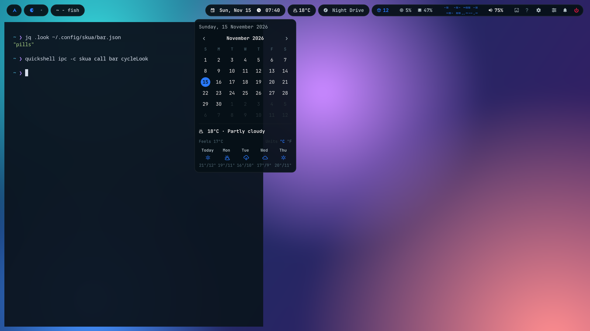
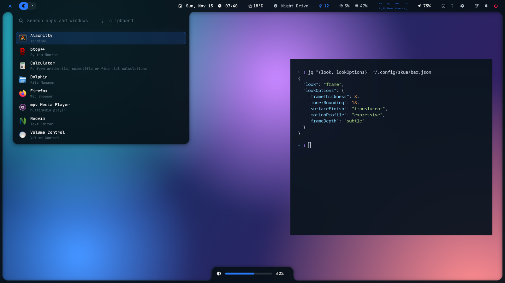
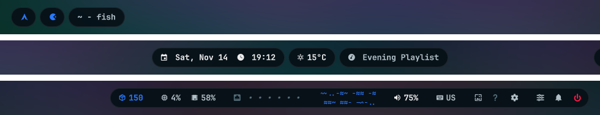

<h1 align="center">
  <picture>
    <source media="(prefers-color-scheme: dark)" srcset="assets/logo/skua-logo-dark.svg">
    
  </picture>
</h1>

A clean top bar for the [niri](https://github.com/YaLTeR/niri) and [Hyprland](https://hypr.land)
desktops, in two looks you can switch between while it runs. **Pills** puts everything in small
floating rounded "pills". **Frame** draws a border around the whole screen, with the bar as its top
edge and the popups as drawers that grow out of it. Both can follow your wallpaper's colors.

A skua is a seabird that steals fish from other birds, hence the logo. Until November 2026 this
project was called tern-bar: its look was inspired by the Tern terminal, but it is not made by or
connected with Tern's developers. Used tern-bar before? See [Coming from tern-bar](#coming-from-tern-bar).

**Pills**: floating pills, and each popup is a card under its pill (here the calendar, under the
clock).



**Frame**: a border around the whole screen with rounded inner corners. The launcher grows out of
the top edge, and the brightness pop-up out of the bottom one.



The pills up close:



(The pictures were taken from a fresh copy on a 1600x900 screen, with the network, microphone,
keyboard-layout and battery pills hidden to save room; the weather, the update count and the music
are stand-ins.)

## What you get

- Workspaces (scroll over them to switch; on Hyprland an open scratchpad shows as one more chip) and the
  name of the window you're using
- An app launcher built into the bar: apps, open windows, a calculator, clipboard history and
  power actions, in a card that drops out of the launcher pill
- Quick settings: Wi-Fi (pick a network, type its password), Bluetooth (find, pair, connect and forget
  devices), Do Not Disturb, night light, keep awake, microphone mute, the sound output and input, screen
  brightness and microphone input volume sliders, and power profile
- Notifications: pop-ups in the top-right corner, and every notification kept under the bell, with
  Do Not Disturb — the bar is your notification daemon, so swaync, mako or dunst are not needed
- A month calendar and a five-day weather forecast under the clock and weather pills
- A small volume or brightness pop-up whenever the volume or screen brightness changes
- Date, time and current weather (condition icon + temperature, no API key needed)
- What's playing, with an expanded media player card (album art, track progress/seek bar, previous /
  play-pause / next, and a player switcher) on left-click, or quick play/pause on right/middle-click
- Pending Arch/Pacman/AUR package updates (`󰏗 <count>`), with a click to update in your terminal
- Active XKB keyboard layout indicator (`󰌌 US`, `JP`, …) from niri or Hyprland, with a click or scroll to switch
- System battery status with charging state and low-battery warnings (hidden on desktops without a battery)
- Microphone input status and mute pill (`󰍬` / `󰍭`) alongside output volume
- CPU and memory at a glance
- Wi-Fi, volume, notifications and a power button
- A system tray with proper right-click menus
- A Tern pill that shows how many Tern windows are open, and opens a terminal tab in one — or a new
  window when none is open (only if you use Tern)
- A wallpaper picker and colour controls, in the same window as the layout editor
- Two looks, Pills and Frame, switched from the same window or with a key (see
  [Looks](#looks))
- An optional little desktop pet — needs the tern-poke plugin for Tern (not released yet)

## Set it up

You'll need [Quickshell](https://quickshell.org) 0.3 or newer, [niri](https://github.com/YaLTeR/niri) or
[Hyprland](https://hypr.land) (tested on 0.57 with a Lua config), and the JetBrainsMono Nerd Font.

```bash
git clone https://github.com/Tsukabe-Admin/skua ~/.config/quickshell/skua
quickshell -c skua
```

To start it every time you log in, and to make the settings window float, add this to your niri
config (`~/.config/niri/config.kdl`):

```kdl
spawn-at-startup "quickshell" "-c" "skua"

window-rule {
    match title="^skua settings$"
    match title="^Wallpaper folder$"
    open-floating true
}

binds {
    Mod+B repeat=false { spawn "quickshell" "ipc" "-c" "skua" "call" "settings" "toggle"; }
    Mod+W repeat=false { spawn "quickshell" "ipc" "-c" "skua" "call" "settings" "wallpaper"; }
    Mod+Space repeat=false { spawn "quickshell" "ipc" "-c" "skua" "call" "launcher" "toggle"; }
    Mod+V repeat=false { spawn "quickshell" "ipc" "-c" "skua" "call" "launcher" "clipboard"; }
    Mod+Return repeat=false { spawn "quickshell" "ipc" "-c" "skua" "call" "tern" "open"; }
    Mod+N repeat=false { spawn "quickshell" "ipc" "-c" "skua" "call" "bar" "notifications"; }
    Mod+Shift+N repeat=false { spawn "quickshell" "ipc" "-c" "skua" "call" "notifications" "clear"; }
    Mod+Shift+D repeat=false { spawn "quickshell" "ipc" "-c" "skua" "call" "notifications" "toggleDnd"; }
}
```

Keep the `repeat=false`: niri repeats a bind for as long as its key is held, and a repeated toggle
opens and closes the window many times a second.

(If you already have a `binds { }` block, put those lines inside it instead. Other things a key can call:
`launcher power`, `launcher close`, `bar calendar`, `bar media`, `bar quickSettings`, `bar notifications`,
`bar close`, `bar cycleLook`, `settings look`, `settings ascii`, `notifications clear`,
`notifications toggleDnd`, `tern open`.)

The bar is also your notification daemon: take swaync, mako or dunst out of your autostart. While one
of them runs, the bar logs two warnings about it and takes over the moment it exits.

Edit any file and the bar updates on the spot. Your own settings are saved in
`~/.config/skua/`, never inside this folder, so `git pull` is always safe.

### On Hyprland

Add this to your Hyprland config (`~/.config/hypr/hyprland.lua`; Hyprland 0.57 reads only Lua
configs):

```lua
hl.on("hyprland.start", function() hl.exec_cmd("quickshell -c skua") end)
hl.window_rule({ match = { title = "^skua settings$" }, float = true })
hl.window_rule({ match = { title = "^Wallpaper folder$" }, float = true })
hl.bind("SUPER + B", hl.dsp.exec_cmd("quickshell ipc -c skua call settings toggle"))
hl.bind("SUPER + W", hl.dsp.exec_cmd("quickshell ipc -c skua call settings wallpaper"))
hl.bind("SUPER + SPACE", hl.dsp.exec_cmd("quickshell ipc -c skua call launcher toggle"))
hl.bind("SUPER + V", hl.dsp.exec_cmd("quickshell ipc -c skua call launcher clipboard"))
hl.bind("SUPER + RETURN", hl.dsp.exec_cmd("quickshell ipc -c skua call tern open"))
hl.bind("SUPER + N", hl.dsp.exec_cmd("quickshell ipc -c skua call bar notifications"))
hl.bind("SUPER + SHIFT + N", hl.dsp.exec_cmd("quickshell ipc -c skua call notifications clear"))
hl.bind("SUPER + SHIFT + D", hl.dsp.exec_cmd("quickshell ipc -c skua call notifications toggleDnd"))
```

On Hyprland 0.55 or 0.56 with a `hyprland.conf`, write the same lines in that file's syntax
(`exec-once`, `windowrule`, `bind`); the bar sends Hyprland its old-style commands there. That
combination was not tested.

Hyprland does not repeat a bind while its key is held unless you ask it to, so nothing like niri's
`repeat=false` is needed. The launcher card asks for its own blur (ext-background-effect), so no
layer rule is needed either. On Hyprland, Lock uses `hyprlock` and Log out uses `hyprshutdown` when
they are installed. The `?` button and the launch animation are niri only.

### Other programs it uses

Each one is only needed for the part it powers; the rest of the bar works without it.

| Program | Used for |
|---|---|
| `awww` (and its `awww-daemon`) | setting the wallpaper (Wallpaper tab) |
| `matugen` | colours taken from the wallpaper (the built-in themes don't need it) |
| `jq`, `python3` | the wallpaper, colour and weather scripts |
| `zenity` | the "Change folder…" picker |
| `cliphist`, `wl-clipboard` | clipboard history in the launcher (with `wl-paste --watch cliphist store` running); copying calculator answers |
| `swaylock` | Lock and Suspend (without it `loginctl lock-session` is sent instead, which only locks if a screen locker is listening for it) |
| `wlsunset` | night light |
| `brightnessctl`, `/sys/class/backlight` | the screen brightness slider in quick settings and the brightness OSD (hidden when no backlight device exists) |
| `checkupdates` (`pacman-contrib`), `paru` or `yay` | the package updates pill (hidden when 0 updates are pending or `pacman` is absent); a click runs the upgrade with `paru`, `yay` or `sudo pacman -Syu` |
| a terminal: `$TERMINAL`, else the first of `xdg-terminal-exec`, `kitty`, `foot`, `alacritty`, `ghostty`, `wezterm` | the upgrade started from the updates pill (without one the click does nothing), and launcher entries that run in a terminal |
| `systemd` (`systemctl`, `loginctl`, `busctl`, `udevadm`) | Suspend, Reboot and Power off; Lock when swaylock is missing; finding the power-profile service; backlight uevents |
| `power-profiles-daemon`, UPower | the power profile switch; the system battery pill (hidden on desktops without a battery) |
| BlueZ | the Bluetooth tile; finding, pairing, connecting and forgetting devices |
| Rust (`cargo`), once, to build `tools/bt-agent` | pairing devices that ask for a PIN, a passkey or a number check (see **Bluetooth** below) |
| `blueman` (optional) | the "Bluetooth settings" button |
| NetworkManager | the Wi-Fi tile and the list of Wi-Fi networks; `nm-connection-editor` for networks that need more than a password |
| `pavucontrol`, PipeWire | right-click on volume or microphone; the volume and microphone pills and quick-settings controls, choosing the sound output and input |
| `ip` (iproute2), `nm-connection-editor`, `nmcli` or `iwgetid` | the network pill (it reads "Offline" without `ip`); right-click on network; the Wi-Fi name |
| `notify-send` | the "IP hidden / shown" message |
| `tern` | the Tern pill — it hides itself when `tern` isn't on your PATH or in `~/.local/bin` |
| tern-poke (a Tern plugin, not released yet) | the PokeToken pill and the desktop pet — both stay hidden without it |

## Looks

A look is how the bar sits on the screen; the colours are a separate choice (see the next section).
Pick one in the settings window's **Look** tab (`quickshell ipc -c skua call settings look` opens
it), or switch to the other one with `quickshell ipc -c skua call bar cycleLook`, which you can
bind to a key. The change applies at once, on every screen, and is saved in
`~/.config/skua/bar.json`.

- **Pills** (the default): floating pills under an 8 px gap, with each popup as a card under
  its pill.
- **Frame**: a border around the whole screen. The bar is its top edge. The calendar, media,
  quick settings and notification popups, and the launcher, become drawers that grow out of that
  edge under their pill and retract into it; Esc or a click outside closes one. The volume and
  brightness pop-up is a tab in the bottom edge. New notifications appear inside the top-right
  corner. Tray menus and the password and pairing questions are still floating cards.

The Look tab has five settings for Frame, and **Reset Frame** puts them back:

| Setting | Choices | `lookOptions` key in `bar.json` |
|---|---|---|
| Border thickness | 4 to 14 px (8) on the left, right and bottom; the top edge is the bar | `frameThickness` |
| Corner rounding | 8 to 28 px (18) for the screen's inner corners; drawers follow it up to 20 px | `innerRounding` |
| Surface finish | Translucent 92% or Solid Ink | `surfaceFinish`: `"translucent"` or `"solid"` |
| Motion feel | Expressive (a slight bounce on things that slide) or Calm | `motionProfile`: `"expressive"` or `"calm"` |
| Frame depth | Off, Subtle or Medium: a soft shadow the frame casts inwards | `frameDepth`: `"off"`, `"subtle"` or `"medium"` |

```json
"look": "frame",
"lookOptions": { "frameThickness": 8, "innerRounding": 18, "surfaceFinish": "translucent",
                 "motionProfile": "expressive", "frameDepth": "subtle" }
```

Things to know:

- The frame takes its thickness from every edge, so windows get that much smaller.
- A fullscreen window covers the bar in both looks. An open popup or the launcher closes when a
  window goes fullscreen, and popups stay shut until it leaves. The launcher and the volume pop-up
  still work over it, as floating cards.
- Frame draws one see-through surface over the whole screen, so anything that moves in the
  bar (the ASCII pill) redraws more than it does in Pills. Measured idle on two monitors:
  about 1.3% of one CPU core against 1.0%.

## Wallpaper and colors

The settings page has four tabs: **Layout** (see [Make it yours](#make-it-yours)), **Look** (see
[Looks](#looks)), **Wallpaper** and **ASCII**.
The Wallpaper tab is a thumbnail grid of your wallpaper folder (`~/Pictures/Wallpapers` until you
pick another) — search, favourites, shuffle and automatic rotation — plus a per-screen choice (one
image everywhere, or a single screen with its own), fill mode and edge colour, animated
transitions, and the colour controls below. Wallpapers are drawn by `awww`; the bar starts it when
needed and puts your wallpaper back every time it starts. Until you pick one, the bar leaves your
desktop's wallpaper alone.

Everything the tab does is two scripts in `scripts/`: `wallpaper.sh` puts an image on screen and
`theme-sync.sh` recolours. Your choices are saved in `~/.config/skua/wallpaper.json`; the bar is
its only writer.

### Colors from the wallpaper

With "Colours from wallpaper" on (and [matugen](https://github.com/InioX/matugen) installed), the
bar takes its colours from the *All screens* image, using the Material scheme and contrast you
pick. Without a wallpaper or matugen, it keeps its built-in dark blue colours. The bar always uses
the dark variant, whatever the wallpaper. Warning and OK colours stay yellow and green so they keep
their meaning.

If you already use matugen for other apps, nothing extra is needed: the same run also renders
the templates in your `~/.config/matugen/config.toml`.

### Built-in themes

Turn "Colours from wallpaper" off and the bar is painted from one of ten presets — Catppuccin
Mocha, Tokyo Night, Nord, Gruvbox Dark, Dracula, Rosé Pine, Everforest Dark, Kanagawa Wave, One
Dark, Solarized Dark — listed in `themes/presets.json`. They don't need matugen. Changing the
wallpaper then leaves the colours alone. If matugen is installed, your matugen templates follow
the preset too: a preset has thirteen colours, and every other Material role a template may ask
for is one of them or a mix of two (shadow and scrim are black).

### Recolour your other apps

After every recolour, `theme-sync.sh` runs `~/.config/skua/theme-hook.sh` if it exists and is
executable, as `theme-hook.sh <colors.json> <label>`. `colors.json` holds every Material colour
role in matugen's format (`.colors.primary.default.color`, …), and `<label>` is the theme's name
or the wallpaper's file name. Use it to reload apps that don't notice new colours on their own,
for example `pkill -SIGUSR1 kitty`.

### Using your own matugen setup instead

If you'd rather run matugen yourself (from another wallpaper tool), add this to
`~/.config/matugen/config.toml` and don't use the Wallpaper tab's colour switch:

```toml
[templates.skua]
input_path = "~/.config/quickshell/skua/matugen/palette.json"
output_path = "~/.local/state/skua/palette.json"
```

The bar watches that file and fades to the new colours. To change which Material You colour feeds
which part of the bar, edit `matugen/palette.json`.

## Make it yours

- **Sizes and the fallback colors:** the colours are in `singletons/Theme.qml`; the sizes of each look
  (bar height, margins, radii, spacing) are in `singletons/Looks.qml`.
- **Crowded rows:** in Pills a row with four or more visible pills merges into one continuous
  island (`pillMergeThreshold` in `singletons/Looks.qml`). Set it to 5 to keep more capsules separate.
- **Rearrange the bar:** open the settings page — the gear in the tools pill, a right-click on the
  launcher, or Mod+B — then drag a pill to another group or click it to show/hide it. Every change
  lands in `~/.config/skua/bar.json`, and the page applies to all screens at once. Right-clicking the Tern pill
  still hops it straight to the next group. Any other key can call the same thing:
  `quickshell ipc -c skua call settings toggle` (also `open` / `close`). You can edit `bar.json` by
  hand too (restart the bar afterwards). If the edit leaves it invalid, the bar starts with the default
  layout, says so in its log, and keeps your text in `bar.json.bad` instead of losing it.
- **Wallpaper:** Mod+W, or the wallpaper button in the tools pill, opens the settings page straight
  on its Wallpaper tab — `quickshell ipc -c skua call settings wallpaper` does the same, and
  pressing it again closes the page.
- **Album art:** the media popup only loads local cover art (`file:`, `image:`, `data:image`), because a
  remote `https` cover is a tracking pixel the player controls. Start the bar with `SKUA_REMOTE_ART=1`
  to allow it.
- **Launch animation:** there's a fancy "grow into a new window" effect. It's off by default. Turn it
  on with `morphEnabled` in `singletons/BarConfig.qml`, but don't run it in a loop.
- **Keybinding cheat sheet:** the `?` button in the tools pill shows niri's built-in hotkey overlay
  (niri only).
- **Launcher:** click the launcher pill (or Mod+Space). Type to search apps and open windows; type
  a sum like `2*(3+4)` to see the answer (Enter copies it; whole numbers are exact up to
  9,007,199,254,740,991, anything larger or with a fraction is shown to 10 significant digits); start
  with `;` to search clipboard history. Up/Down pick, Enter opens, Esc clears and then closes. Apps
  you open often move to the top (counts in `~/.local/state/skua/launcher.json`). The ⏻ button
  opens the power actions; Log out, Reboot and Power off need a second Enter (or click) within 3
  seconds. Holding Enter down does not count, and moving the selection or typing cancels it.
- **Quick settings:** the sliders button in the right-hand pill. **Calendar:** click the clock.
- **Wi-Fi:** in quick settings, the networks around are listed while the card is open (the radio only
  scans then). Click one to connect; one that needs a password asks for it in a small window under the
  bar (**Show** reveals what you typed), and asks again if it was wrong. Click the connected one to
  disconnect; point at a saved one for **Forget**, which asks for a second click. A network that needs
  more than a password (a company or school login) says "Needs settings" and opens
  `nm-connection-editor`.
- **Sound output and input:** with more than one speaker, headset or HDMI output (or microphone),
  quick settings lists them; click one to make it the one in use.
- **Keep awake:** the coffee tile in quick settings stops the screen from dimming, locking or sleeping
  on its own. A coffee cup in the right-hand pill shows it is on (click it to turn it off), and it is
  off again after a restart of the bar.
- **Notifications:** new ones pop up in the top-right corner of the focused screen. One stays as long
  as its app asks, else 6 seconds (3 for low-priority ones); critical ones stay until you close them,
  and the pointer over one keeps it up. Click one for its app's default action, × to dismiss it. The
  bell (or Mod+N) opens every notification still kept, the newest 50, with **Do not disturb** and
  **Clear all**; a right-click on the bell toggles Do Not Disturb, which keeps everything but critical
  notifications off the screen and is saved in `bar.json`. Text arrives as plain text: links and
  pictures inside a message are not shown, and an app's picture is shown only when it is a local file
  or icon.
- **Bluetooth:** in quick settings, **Find devices** searches for a minute (or until you close the card
  or press **Stop**). Put the device in pairing mode and click it in the list: it is paired, trusted and
  connected. Click a paired device to connect or disconnect it; point at it for **Forget**, which asks
  for a second click. Devices that need no code (headphones, speakers, mice, game controllers) pair
  as they are. For the ones that ask for a PIN, a passkey or "does the device show this number?",
  install the pairing helper once and restart the bar:

  ```bash
  cargo install --path tools/bt-agent --root ~/.local    # puts skua-bt-agent in ~/.local/bin
  ```

  The bar then shows each question in a small window under the bar (on its own, too, when a device
  asks to pair or connect while the card is closed). Nothing is accepted without your click or the
  code you type. While the bar runs, the helper is your computer's Bluetooth pairing agent, and BlueZ
  keeps the adapter pairable; it is never made discoverable. `~/.local/bin` has to be on the `PATH`
  the bar starts with. See `tools/bt-agent/README.md`.
- **Your IP stays hidden:** the network pill shows only the Wi-Fi name until you click it; click
  again to hide the IP. The choice is the file `~/.local/state/skua/show_ip`.
- **Weather lookup:** the weather pill is on by default and asks a geolocation service
  (`ipwho.is`, or `wttr.in`) where you are, then fetches the forecast from Open-Meteo — no API
  key, but your IP is sent. Set `SKUA_WEATHER_LOCATION="City"` or
  `SKUA_WEATHER_COORDS="lat,lon"` in the bar's environment to skip the IP lookup.
- **Weather units:** open the forecast (click the weather or clock pill) and tap °C / °F. The
  choice is saved in `bar.json` (`weatherFahrenheit`); it re-formats the cached numbers, so no new
  fetch is needed.
- **Environment variables:** settings and generated files follow `XDG_CONFIG_HOME` and
  `XDG_STATE_HOME`; the folders named in this README are the defaults. `TERMINAL` chooses the
  terminal. For trying things without the real hardware or network: `SKUA_BATTERY_MOCK="85:charging"`,
  `SKUA_BACKLIGHT_DIR` (a folder to use instead of `/sys/class/backlight`),
  `SKUA_UPDATES_MOCK=<count>`, `SKUA_CHECKUPDATES_CMD`, `SKUA_WEATHER_MOCK=<json>`, and the
  weather script's servers: `SKUA_WEATHER_METEO_URL`, `SKUA_WEATHER_WTTR_BASE`,
  `SKUA_WEATHER_GEO_URL`, `SKUA_WEATHER_GEOCODE_URL`.
- **Tray menus** close when you click anywhere else. A submenu opens in place, with a **Back** row.
- **ASCII animations:** the settings window's **ASCII** tab (right-click the ASCII pill, or
  `quickshell ipc -c skua call settings ascii`) picks a look, colour, speed, size and brightness for
  an animated ASCII wallpaper and renders it to a GIF that `awww` plays (about 15–45 s; saved in
  `<wallpaper folder>/ascii/`). The same tab sets the bar pill's piece, colour and speed, which apply
  at once; left-click the pill for the next piece. Choices are saved in `~/.config/skua/ascii.json`.
  The launcher's "No matches" line uses the same player. The frames are plain text in `assets/ascii/`,
  so nothing is computed while the bar runs. Everything is made by `tools/ascii/gen.mjs` from
  [ascii.rest](https://github.com/bas3line/ascii) (MIT) looks. The pill, previews and launcher line work
  out of the box; rendering a wallpaper also needs `node`, `ffmpeg` and a one-time `npm install` in
  `tools/ascii` (the tab says which is missing). See `tools/ascii/README.md`.

## What's inside

```
shell.qml               starts the bar on every screen
components/             the bar and each of its pills, and the two looks' hosts (PillsHost, FrameHost)
components/views/       what is inside each popup, shared by the Pills cards and the Frame drawers
singletons/             shared pieces: theme, looks, settings, wallpaper, compositor connection (niri, Hyprland)
shaders/                the Frame look's shadows: GLSL sources and the compiled .qsb files the bar loads
scripts/                helpers: wallpaper, colours, network status, IP hiding
themes/                 the ten built-in colour themes
matugen/                an optional template, for driving the colours from your own matugen setup
screenshots/            pictures for this page
assets/ascii/           text frames for the ASCII pill and the launcher's empty state
assets/logo/            the logo: app icon, the bird alone, and the heading for light and dark pages
tests/                  unit tests for the script libraries (node --test tests/)
tools/ascii/            generator for those frames and for animated ASCII wallpapers (needs node)
tools/bt-agent/         the Bluetooth pairing helper, in Rust (see Bluetooth above)
tools/build-shaders.sh  rebuilds the compiled shaders after a change to their sources
```

## Coming from tern-bar

Skua is tern-bar under a new name, with the same features. To move an existing install over, stop the
bar and move its folders (these are the default places; use yours if you set `XDG_CONFIG_HOME` or
`XDG_STATE_HOME`):

```bash
quickshell kill -c tern-bar
mv ~/.config/quickshell/tern-bar ~/.config/quickshell/skua
mv ~/.config/tern-bar ~/.config/skua
mv ~/.local/state/tern-bar ~/.local/state/skua
git -C ~/.config/quickshell/skua remote set-url origin https://github.com/Tsukabe-Admin/skua
```

Then, in your niri or Hyprland config, change every `-c tern-bar` to `-c skua` and the settings
window's title rule to `^skua settings$`. Rename any `TERN_BAR_…` variable you set to `SKUA_…`, and
in a matugen template `[templates.tern-bar]` becomes `[templates.skua]` with the new paths. If you
installed the Bluetooth pairing helper, install it again under its new name and remove the old one:

```bash
cargo install --path ~/.config/quickshell/skua/tools/bt-agent --root ~/.local
rm ~/.local/bin/tern-bar-bt-agent
```

Start the bar with `quickshell -c skua` (or log out and in again).

## If it misbehaves

To restart it by hand on niri:

```bash
quickshell kill -c skua
NIRI_SOCKET=$(ls /run/user/$UID/niri.wayland-1.*.sock) quickshell -c skua --daemonize
```

On Hyprland, run `quickshell kill -c skua` and then `quickshell -c skua --daemonize` from a
terminal inside Hyprland, which already has `HYPRLAND_INSTANCE_SIGNATURE`.

Without `NIRI_SOCKET` (niri) or `HYPRLAND_INSTANCE_SIGNATURE` (Hyprland) the bar still starts, but
workspaces and the window name stay empty.

## An experiment in vibecoding

This bar is an experiment in **vibecoding** — building software by describing what you want to an
AI coding agent and iterating on what it produces. The code here was mostly written by Claude Code
and OMP while I described the behaviour, tested it on the live desktop and decided what shipped.
It is a new way to work, and I wanted to see how far it can go: not a toy demo, but a daily-driver
bar with a launcher, settings, wallpaper tools, weather, media controls and the rest.

It runs every day on my machine (Arch, niri, Quickshell 0.3.2, two monitors), in the Frame look.
Hyprland support, in both looks, was checked in a nested Hyprland 0.57 with a Lua config, but is
not used day to day yet. The brightness pop-up was checked against a stand-in backlight folder: the
machine has no backlight. It has not been tested on every distro, GPU or Quickshell version, so
treat it as a working experiment rather than a finished product. The parts that matter were checked
on the live desktop, not only compiled.

Bug reports, ideas, pull requests and questions are welcome — especially from people who know QML
or Quickshell better than I do. Screenshots of odd behaviour are just as useful as patches. I am
happy to help with this project or any other; open an issue or say hello. See
[CONTRIBUTING.md](CONTRIBUTING.md) for what is useful in a report or a PR.

## License

MIT. See `LICENSE`.
